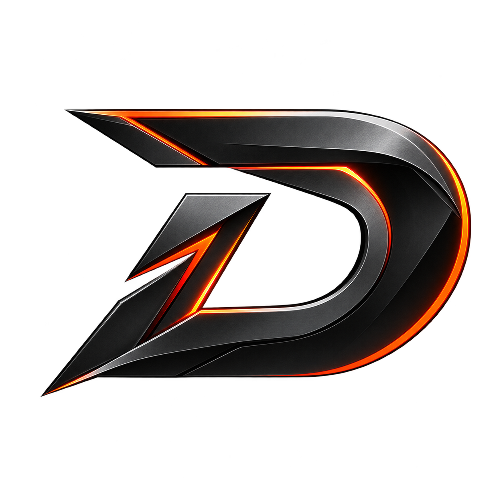

<div align="center">
  
  <br/><br/>
  
  <h1>DRAZVIO</h1>
  <p><strong>DRIFT • DEATHMATCH • SAN ANDREAS MULTIPLAYER</strong></p>
  <p>Игровой сервер SA-MP с упором на дрифт, сражения и свободную игру.<br/>
  Исходники, инструменты сборки и история разработки — в одном месте.</p>
  <p>
    <a href="https://github.com/Zeihos/Drazvio/actions/workflows/pawn-build.yml"></a>
    <a href="https://github.com/Zeihos/Drazvio/actions/workflows/filefunctions-compat.yml"></a>
  </p>
  <p>
    
    
    
  </p>
  <p>
    <a href="#о-проекте">О проекте</a> ·
    <a href="#возможности">Возможности</a> ·
    <a href="#запуск-и-сборка">Запуск</a> ·
    <a href="#разработка">Разработка</a> ·
    <a href="#обратная-связь">Обратная связь</a>
  </p>
</div>

---

## О проекте

**DRAZVIO** — игровой проект на базе **SA-MP 0.3.7-R2**. В его основе — большой мод на **Pawn**, дополненный фильтрскриптами и серверными плагинами. Мы дорабатываем существующие игровые системы, исправляем ошибки и готовим стабильную версию **1.0**.

> **Текущий этап — разработка и тестирование.** Автоматическая компиляция и проверка запуска сервера проходят в GitHub Actions, но полноценное тестирование с игроками ещё не завершено. Публикуемые CI-архивы — **тестовые**, не официальный релиз.

## Возможности

| 🎮 Игровое направление | Что уже есть в кодовой базе |
| :--- | :--- |
| **Drift** | Дрифт-механики, транспорт и связанные игровые команды |
| **DeathMatch** | Боевые режимы, награды и события |
| **Прогресс игрока** | Аккаунты, баланс и сохранение данных |
| **Игровой мир** | Дома, гаражи, бизнесы и банды |
| **Управление сервером** | VIP-возможности, администрирование и защита от злоупотреблений |

<sub>Наличие системы в исходниках не означает, что все её сценарии уже прошли игровые тесты.</sub>

## Запуск и сборка

### Хочу посмотреть или протестировать сервер

1. Откройте [**GitHub Actions → проверка сервера**](https://github.com/Zeihos/Drazvio/actions/workflows/filefunctions-compat.yml).
2. Выберите последний успешный запуск на ветке `main`.
3. В разделе **Artifacts** скачайте `DRAZVIO-SERVER-TEST`.
4. Перед запуском выполните инструкции из [**руководства по установке**](docs/INSTALL.md).

**Важно:** тестовый архив формируется по строгому списку допустимых файлов и проверяется отдельным тестом; он не содержит реальных аккаунтов и персональных данных. Создайте собственный `server.cfg`, сохраните резервные копии своих данных и не открывайте тестовый сервер в интернет без проверки настроек.

### Хочу работать с исходниками

```powershell
git clone https://github.com/Zeihos/Drazvio.git
cd Drazvio
python tools/drazvio.py check
./tools/build.ps1
```

Скомпилированные `.amx` сохраняются в папку `build-amx/`. Команда сборки **не перезаписывает** действующие файлы сервера. Подробности — [в инструкции по разработке](docs/DEVELOPMENT.md).

## Структура проекта

```text
Drazvio/
├── server/
│   ├── gamemodes/             # основной мод Pawn
│   ├── filterscripts/         # игровые фильтрскрипты
│   ├── pawno/                 # компилятор и include
│   ├── plugins/               # серверные зависимости
│   ├── scriptfiles/           # статические настройки и данные
│   └── server.cfg.example     # пример конфигурации
├── native/filefunctions_compat/  # исходники и тесты DLL
├── assets/branding/           # фирменные материалы
├── tools/                     # сборка и проверка
├── docs/                      # документация на русском
└── .github/                   # CI и шаблоны обращений
```

## Разработка

| Направление | Текущее состояние |
| :--- | :--- |
| **Сборка Pawn** | ✅ Проверяется автоматически на Windows |
| **Запуск полного SA-MP** | ✅ Проверяется с 3 плагинами и 11 фильтрскриптами |
| **FileFunctions** | 🧪 Создан совместимый вариант; тестирование продолжается |
| **Аккаунты и экономика** | 🔧 Продолжаются функциональные проверки |
| **Публичный релиз 1.0** | ⏳ Ещё не выпущен |

Подробные направления развития: **[план работ](docs/ROADMAP.md)**. Технические детали сборки и CI: **[для разработчиков](docs/DEVELOPMENT.md)**.

## Обратная связь

Нашли ошибку или хотите предложить улучшение? Откройте [**Issues**](https://github.com/Zeihos/Drazvio/issues/new/choose) и выберите шаблон обращения. Для предложений по коду — [**правила участия**](CONTRIBUTING.md).

Обнаружили уязвимость, утечку данных или проблему с авторизацией? Прочитайте [**политику безопасности**](SECURITY.md) и не публикуйте секреты в открытых задачах.

---

<div align="center">
  <sub><strong>DRAZVIO</strong> · Drift & DeathMatch · SA-MP 0.3.7-R2</sub><br/>
  <sub>Разработка проекта: <a href="https://github.com/Zeihos">Zeihos</a> · Документация — на русском языке</sub>
</div>
